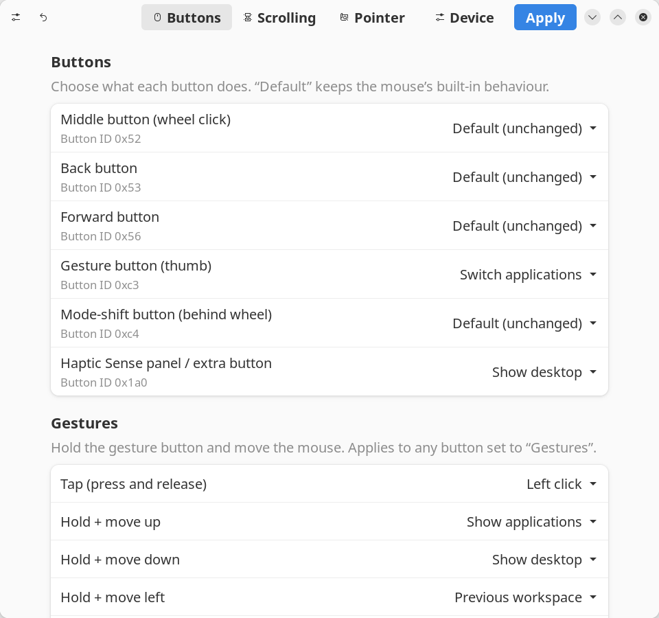
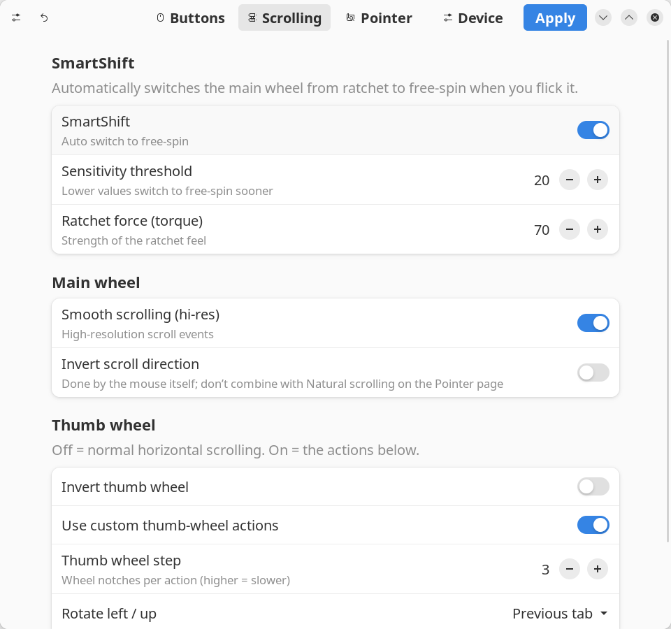
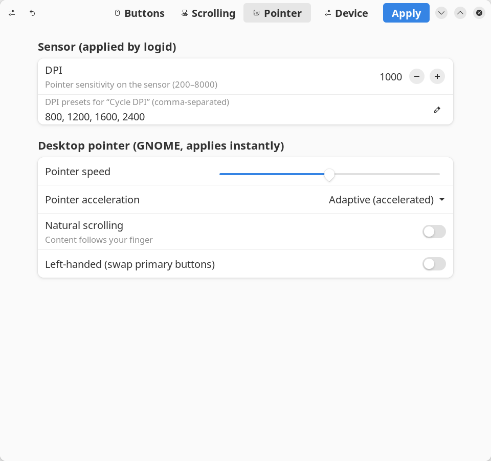
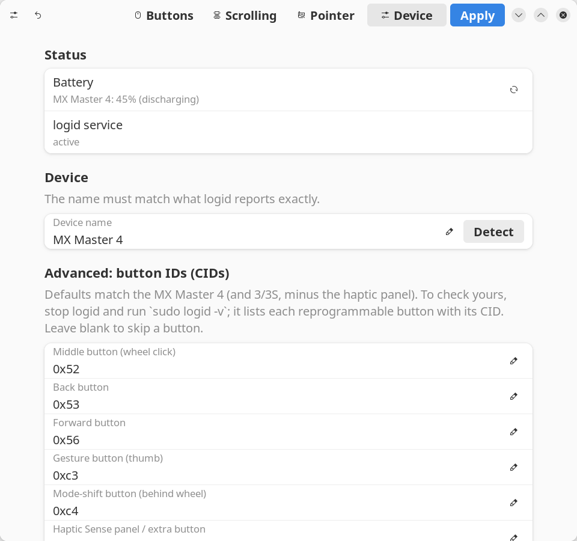

# MX Control

A small Logitech Options+-style configurator for Ubuntu, built with GTK 4 and libadwaita. It edits your
button, gesture, thumb wheel, DPI and SmartShift settings, writes `/etc/logid.cfg`, and restarts
[logiops](https://github.com/PixlOne/logiops) (`logid`), which talks HID++ to the mouse.
Pointer speed, acceleration and natural scrolling go through GNOME's own settings and apply instantly.

Tested with the **MX Master 4** over Bluetooth on Ubuntu (kernel 7.0). The MX Master 3/3S use the same
button IDs, minus the Haptic Sense panel.

<p align="center">
  
</p>

<details>
<summary>More screenshots</summary>

| Scrolling | Pointer | Device |
|---|---|---|
|  |  |  |

</details>

## Install

```sh
git clone https://github.com/ganesh1076/logitech-mx4_controls.git && cd logitech-mx4_controls
./install.sh
```

The script installs the GTK dependencies, puts the app in `~/.local/bin/mx-control` with a launcher in your
app menu, and enables the `logid` service. If logiops is missing or older than 0.3.4, it offers to build
v0.3.5 from source (see below for why).

## Important: logiops 0.3.3 does not work with the MX Master 4

Ubuntu's repositories ship logiops **0.3.3**. With an MX Master 4 it fails like this:

```
[INFO] Device found: MX Master 4 on /dev/hidraw6:255
[WARN] Error adding device /dev/hidraw6: Device timed out
```

**Cause:** the MX Master 4 has a control with CID `0x1a0` (the Haptic Sense panel). In 0.3.3,
`ReprogControlsV4::setControlReporting()` takes the CID as a `uint8_t`, so logid sends `0xa0`. The mouse
replies with an HID++ error, which 0.3.3 ignores, and it waits until it times out. logid resets every control
while adding a device, so this happens with any config, even an empty one. Upstream fixed it in v0.3.4
([commit 700070c](https://github.com/PixlOne/logiops/commit/700070c6510ff72757944a136f9556708a4139f4)).

**Side effect:** before timing out, logid has already diverted the gesture button and thumb wheel to itself.
Once it gives up, nothing handles them, so the **gesture button does nothing and side scrolling stops** until
the mouse is power-cycled or the diverts are cleared (see `tools/mx-undivert.py` below).

**Fix:** use logiops 0.3.4 or newer. `install.sh` does this for you, or do it by hand:

```sh
sudo apt install git cmake g++ pkg-config libevdev-dev libudev-dev libconfig++-dev libglib2.0-dev
git clone --recursive --branch v0.3.5 https://github.com/PixlOne/logiops
cmake -S logiops -B logiops/build -DCMAKE_BUILD_TYPE=Release
cmake --build logiops/build -j"$(nproc)"
sudo apt remove logiops          # the package owns the same systemd unit path; keeps /etc/logid.cfg
sudo cmake --install logiops/build
sudo systemctl daemon-reload && sudo systemctl enable --now logid
```

## MX Master 4 button IDs

| Control | CID |
|---|---|
| Middle (wheel click) | `0x52` |
| Back / Forward | `0x53` / `0x56` |
| Gesture button (thumb) | `0xc3` |
| Mode-shift (behind the wheel) | `0xc4` |
| Haptic Sense panel | `0x1a0` |
| Thumb wheel | feature `0x2150` (touch-sensitive, no tap) |

Verify yours with `sudo systemctl stop logid && sudo logid -v`.

## Troubleshooting

- **Gesture button or side scroll dead after logid failed or crashed:** stop logid and run
  `sudo tools/mx-undivert.py`. It clears any diverted buttons and returns the thumb wheel to native scrolling.
- **Settings keep reverting at login:** Solaar re-applies its own button and thumb wheel settings when it
  starts, which undoes logid's. Use one or the other; with MX Control, remove Solaar (`sudo apt remove solaar`).
- **Check what logid is doing:** the *Show logid log* button on the Device page, or
  `journalctl -u logid -b`.
- **The thumb wheel tap action never fires:** the MX Master 4's thumb wheel detects touch but not taps.

## Updating the screenshots

`tools/screenshots.py` opens the app, renders each tab to `docs/screenshots/` and closes it again.
Add `--defaults` to show default settings instead of your own. Run it with the system Python, which has
the GTK bindings: `/usr/bin/python3 tools/screenshots.py`.

## License

[MIT](LICENSE)
